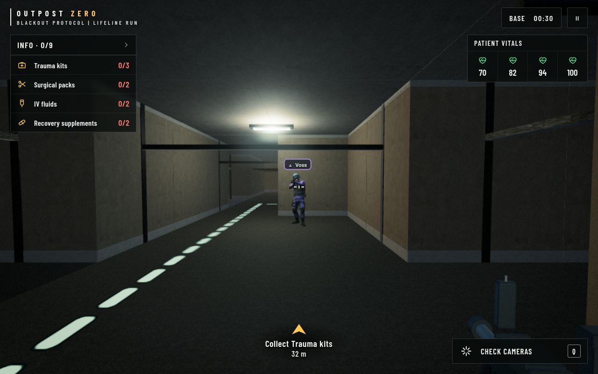
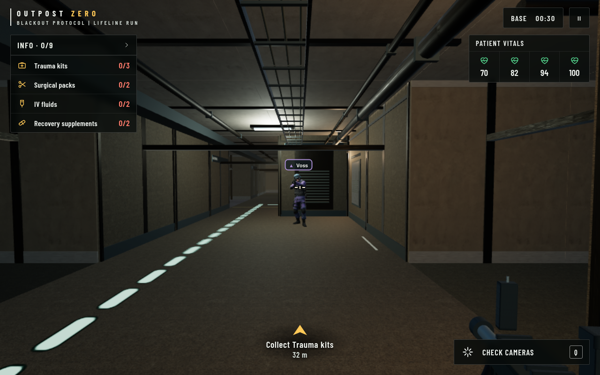
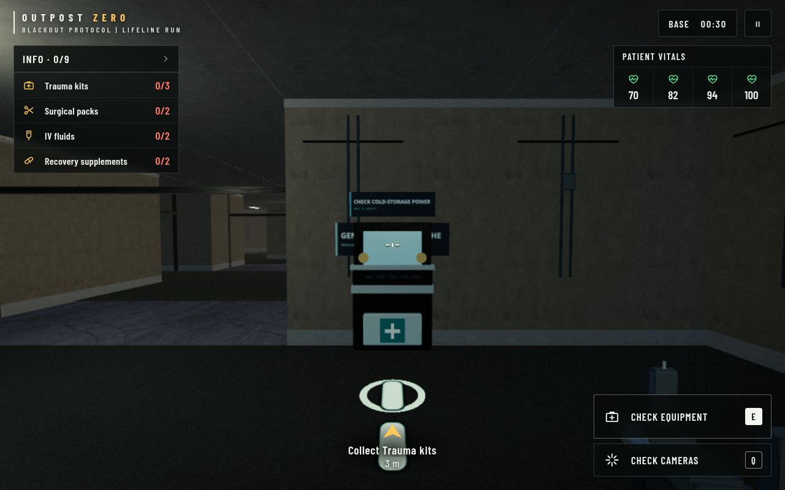
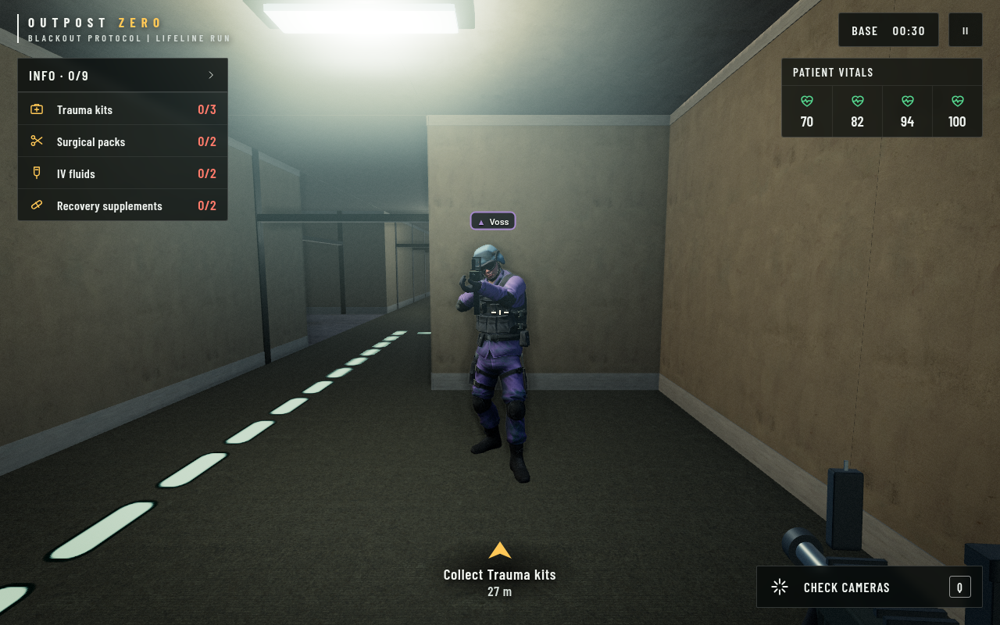
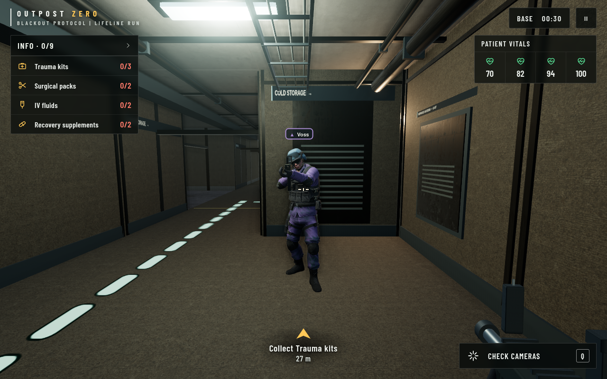

# Outpost Zero graphics benchmark

Review branch: `codex/graphics-benchmark`. Based on `origin/main` at `c44d2bb`.
The first-pass evidence below covers the West Service Corridor and the existing
soldier/weapon material pass. The approved follow-up upgrades shared interactables
and fixes optional loading, the inconsistent grade and the terminal hotspot.
No merge or deployment is included. The medical depot is the latest isolated
room pass; further room-specific environment expansion remains pending review.

**Latest review: [Medical depot and night refinements](medical-depot/README.md)**

[Approved shared interactables and first review fixes](interactables/README.md)

- [Full report: changes, budgets, validation, licences and limitations](REPORT.md)
- [Rendering audit with file:line evidence](AUDIT.md)
- [Before measurements](before.json) · [After measurements](after.json)
- [Desktop/mobile development checks](qa-dev.json) · [Packaged checks](qa-built.json)

## Before / after screenshots

These are real engine captures at matched 1280×800 viewports, seed and cameras.
The existing HUD is preserved. Click a screenshot to inspect it at full size.

| View | Before | After |
|---|---|---|
| Corridor, Balanced |  |  |
| Cold-storage terminal, Balanced |  |  |
| Soldier, High |  |  |

Balanced draw calls stayed below the matching baseline in all four views.
Managed source-texture residency increased by about 20 MiB at its Balanced peak;
this estimate excludes render targets and driver allocations. The browser used
software rendering, so no hardware FPS result is claimed.
