# Shared interactables — review follow-up

Branch: `codex/graphics-benchmark`. Comparison baseline: approved commit
`f2f8d8c`. This pass stops at the requested shared equipment and review fixes;
it does not expand the corridor architecture into other rooms. No deployment
or merge to main is included.

- [Draw calls, triangles, texture memory, download sizes and hotspot measurement](MEASUREMENTS.md)
- [Development equipment checks](qa-dev.json) · [Packaged equipment checks](qa-built.json)
- [Packaged movement/dye/lighting regression](corridor-qa-built.json)
- [Site development smoke](site-dev.json) · [Site packaged smoke](site-built.json)

## Review fixes

- The two operator response PNGs are optional independently. Failed downloads
  log a warning and leave body/helmet roughness at 0.93, skin at 0.76,
  metalness at zero and the original normal strength at 0.55. They do not enter
  the fatal `assetErrors` list. Required scene assets retain their existing
  failure policy. The browser regression deliberately aborts **both** URLs.
- Removed the `inBenchmark` post-processing branch. The restrained benchmark
  grade now applies throughout the base and aircraft on Balanced/High: highlight
  `(1.025, 1.01, 0.98)`, shadow `(0.97, 1, 1.025)`, saturation `1`, vignette
  `0.08`, grain `0.002`. Bloom is High-only, strength `0.12`, threshold `1.35`,
  radius `0.35`. Day/night changes still come from the existing actual lights,
  exposure adaptation and environment; camera location does not select a grade.
  Performance keeps its existing direct-render path, bypassing the composer.
- The extra cold-storage practical is lower and slightly farther from the wall:
  height `2.05 m` instead of `2.85 m`, intensity `2.5` instead of `12`, range
  `4 m` instead of `6 m`. This removes the near-white ceiling wash.

## Shared equipment

One authored trim/material atlas and cached merged geometry serve every copy.
Static equipment uses `batchStaticByMaterial`; movable stock, live screens and
temporary charges remain individually stateful. Equipment has rounded case
edges, recessed displays, rails, fasteners, vents, handles, latches and markings.
Paint, polymer, rubber and exposed metal use distinct roughness/metalness data.
These are **original procedural assets**, not scanned production models.

| Type | Upgrade | Preserved behaviour |
|---|---|---|
| Station terminals | Shared service chassis, category-specific screen artwork, buttons and fasteners | Original mounts and titles; active/completed/power-out screen states. Aircraft helm keeps its existing purpose-built instruments. |
| Medical cabinets | Shelves, structural frame, rails and fasteners | Original wall mounts, stock ownership and interaction distances. Labels at shared mounts sit beside the cabinet to avoid overlap. |
| Medical kit cases | Bevelled shell, lid seam, protective strips, handle, latches and medical cross | Exactly two stock slots per cabinet, stock visibility and aircraft manifest visibility. |
| Supply crates / boxes | Reinforced lid, ribs, latches, handle and medical cargo marking | Original pickup origins, health/removal and supply-drop positions, rotations and source-model dimensions. Static scanned scenery crates remain the existing CC0 assets. |
| Concealed charges | Case, straps, switch, fasteners and separate illuminated LIVE / SAFE plates | Original planted coordinates and public visibility/redaction. No private roles or bomb coordinates are read. |
| Emergency console | Coated enclosure, 24-sided red button, guard rails, fittings and radio label | Original red/yellow identity, stand position and meeting interaction. |

The existing simulation removes disabled bombs instead of publishing a disabled
object. The renderer therefore retains a SAFE shell for four seconds **only**
after a confirmed local defuse notice tied to that player's observed defuse
channel. Disappearance due to redaction removes the model normally. Other
observers retain the existing removal behaviour; no multiplayer schema or
gameplay change is included.

## Screenshots

Real engine captures at the same 1280×800 viewport, fixed seed
`outpost-corridor-20261019` and camera coordinates (in the measurement JSON).
The original HUD is retained.

| View | Approved branch | This pass |
|---|---|---|
| Cold storage: practical and shared equipment | 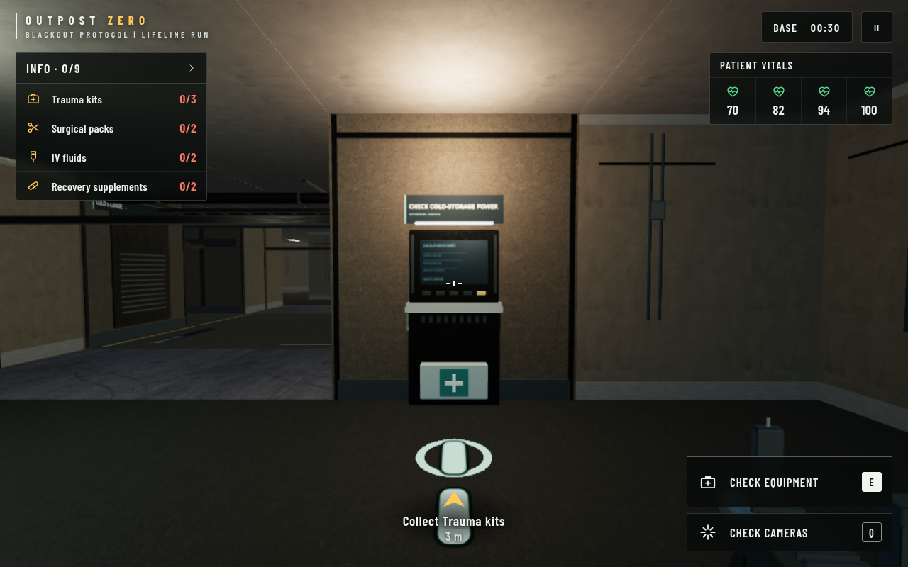 | 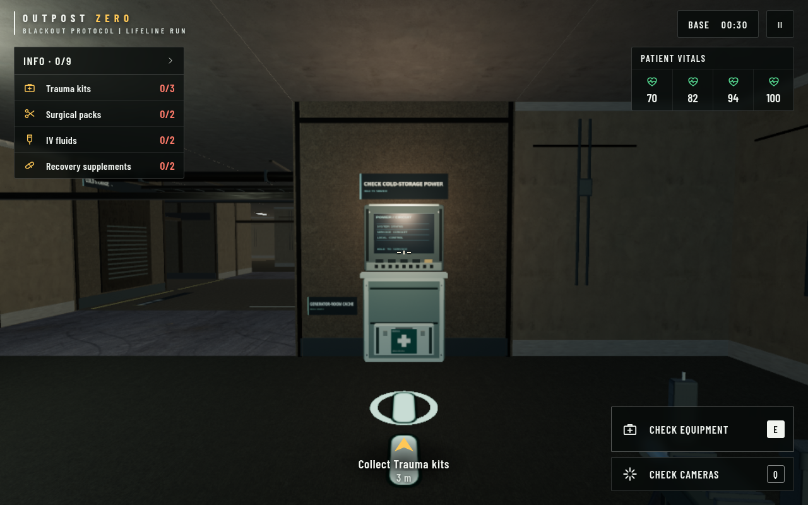 |
| Command room: global grade and emergency console | 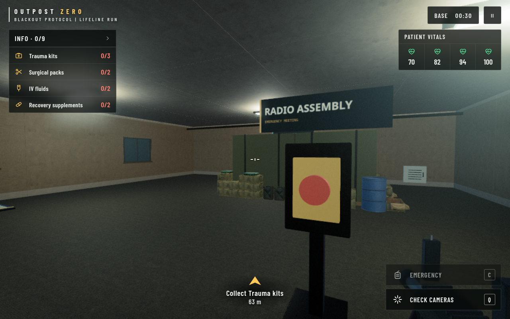 | 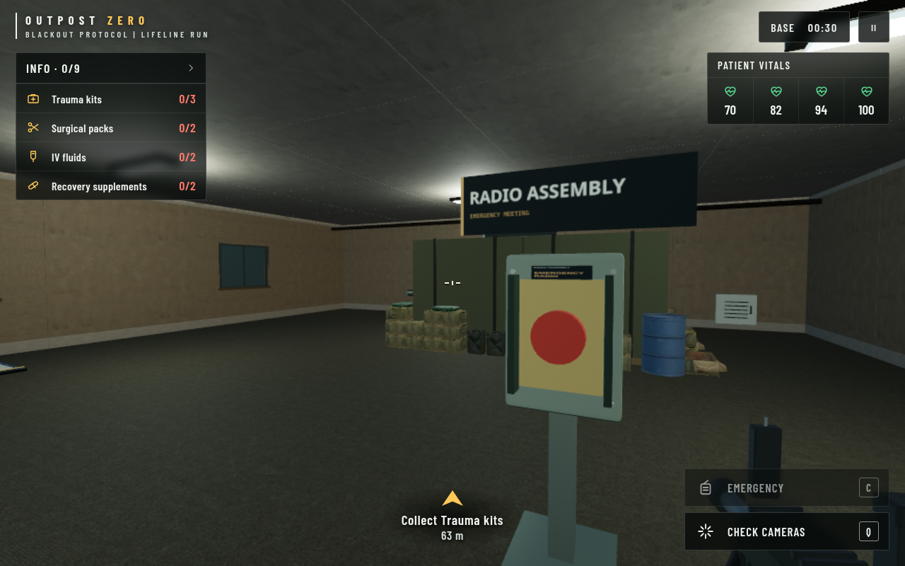 |
| Armory: global grade and service station | 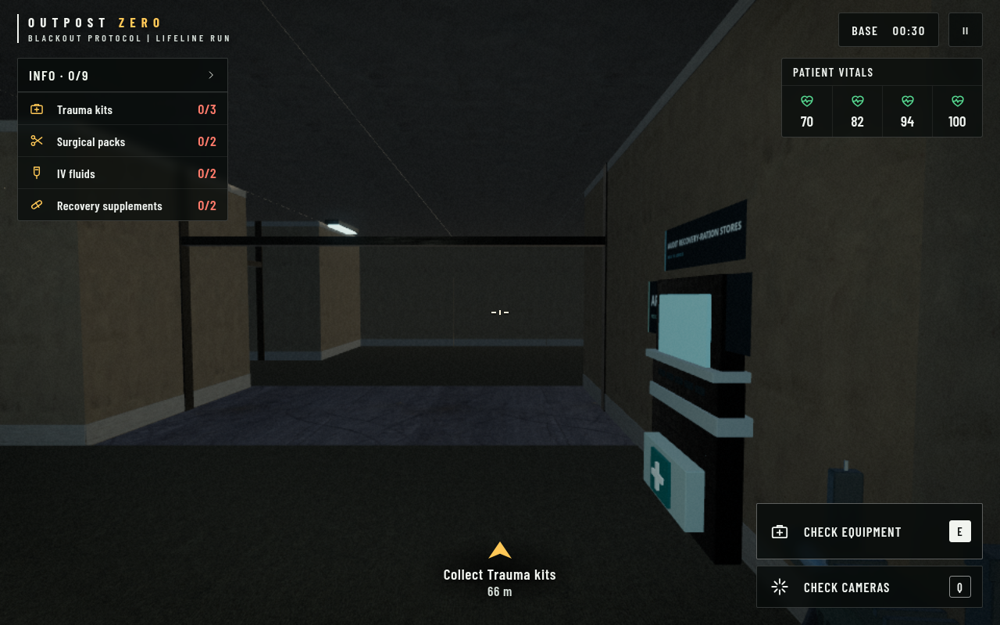 | 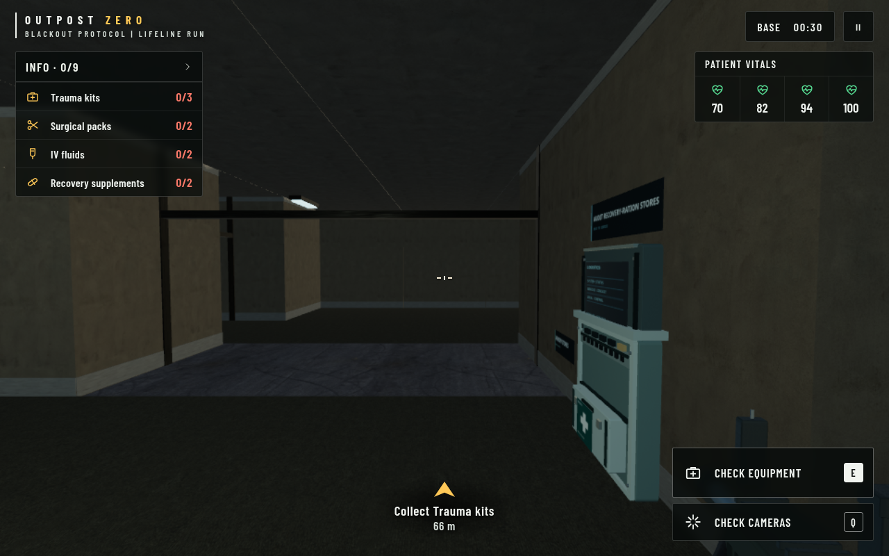 |
| Communications: global grade and service station | 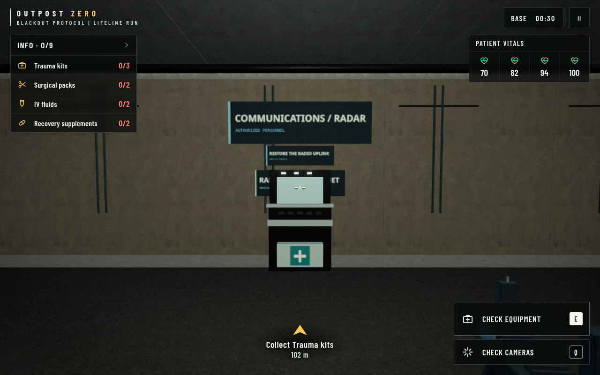 | 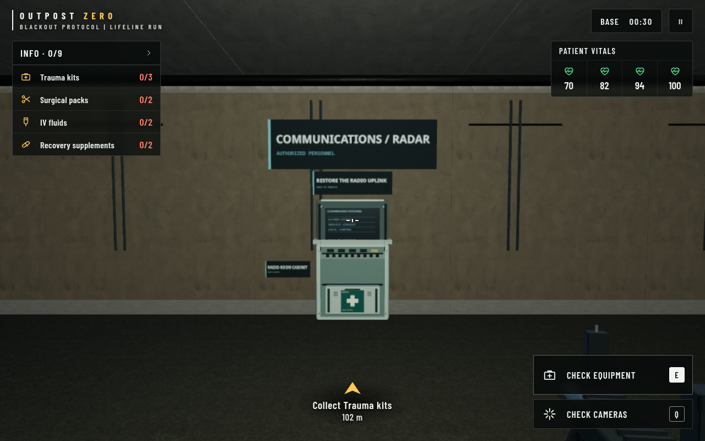 |

| Armed charge | Confirmed local defuse | Touch viewport |
|---|---|---|
| 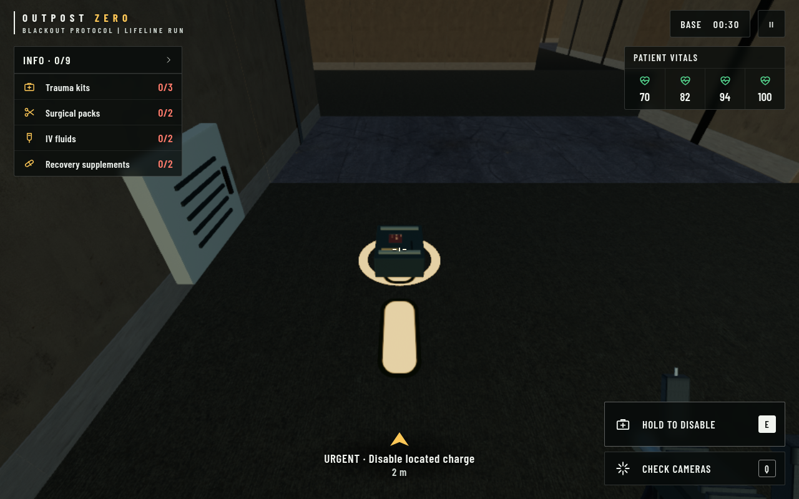 | 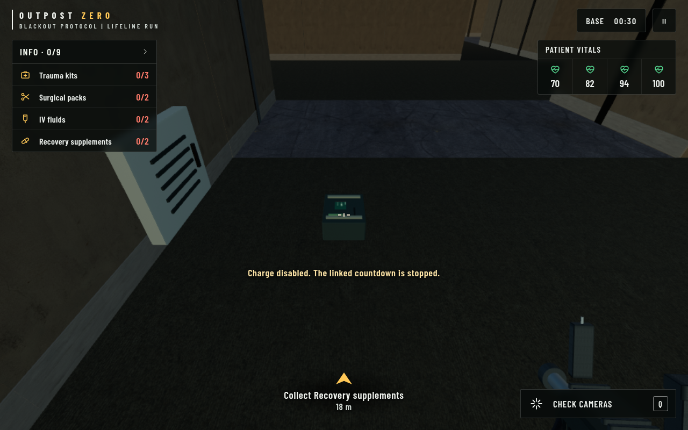 | 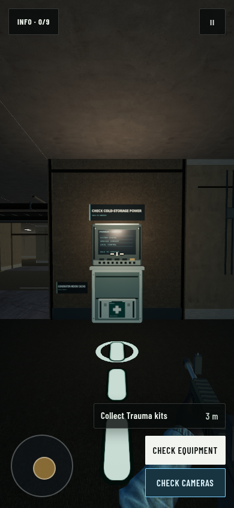 |

## Assets, licences and download size

No new third-party asset downloads. A shared runtime colour canvas atlas is
1024×1024, sRGB; its packed roughness/metalness data atlas is 256×256, linear.
Both use mipmaps and the existing anisotropic filtering cap. Together they cost
approximately **5.67 MiB** of uncompressed source texture storage including
mipmaps. The former corridor-only display atlas is removed. Subtle normal
detail reuses the existing Poly Haven `metal_plate_02` OpenGL normal (CC0):
<https://polyhaven.com/a/metal_plate_02> · <https://polyhaven.com/license>.
Source-name correction during the medical-depot pass; no asset bytes changed.

Compared with the approved bundle, renderer JavaScript increases by 6,152 bytes
uncompressed, approximately 2,118 bytes using Node's default gzip. The existing
39 cached assets remain 32,936,013 bytes; no new model/texture file is added.
Credits are recorded in both `public/games/military/ATTRIBUTION.md` and the
in-game asset credits. This pass does not change the existing Mixamo licensing.

## Reproduction and limits

`scripts/benchmark-outpost-interactables.mjs` uses three samples per pose with
refreshed shadows and counts **all render passes**. It fails when any matching
Balanced view exceeds the approved branch's draw-call count. Set
`OUTPOST_BENCH_WORKLOAD=1` to exercise an active drop, breakable crate and charge;
`OUTPOST_BENCH_BUNDLE` can serve an archived approved bundle for comparison.

Managed source-texture memory is estimated from unique uploaded WebGL texture
handles, dimensions, type and mipmaps. It excludes render targets, internal
PMREM/MSAA and driver allocations and must **not** be interpreted as total GPU
memory. Residency changes as different surfaces become visible; compare the
same warm-up/view sequence. The sandbox uses SwiftShader software rendering;
no frame times are presented as hardware FPS. Real iPad Safari and physical
mobile GPU performance still need device testing.

The next review should approve these shared kits and the global grade before
any room-specific architecture, lighting or environment-art expansion.

## Files changed

| File | Purpose |
|---|---|
| `scripts/outpost-military/realism-characters.js:116` | Independent optional-response loading, warnings and original material fallback. |
| `scripts/outpost-military/interactables.js` | Shared atlases, cached merged equipment geometry and separate stateful displays. |
| `scripts/outpost-military/renderer.js:1126` | Station, cabinet, stock, crate, charge and emergency-console integration; original owners retain transforms and state. |
| `scripts/outpost-military/renderer.js:3058` | Confirmed local-defuse presentation without treating redaction as success. |
| `scripts/outpost-military/renderer.js:3177` | Single base-wide/aircraft grade and preset-only bloom. |
| `scripts/outpost-military/benchmark-corridor.js` | Removed the old special terminal and `inBenchmark` selector; corridor architecture retained. |
| `scripts/outpost-military/realism-events.js` | Shared equipment for event supply drops, retaining original transforms and source dimensions. |
| `public/games/outpost-military.js` | Rebuilt renderer actually loaded by the game. |
| `src/routes/games/outpost-zero.tsx` | Cache-bust token `graphics-interactables-20261019`. No new public module/no-cache entry needed. |
| `public/games/military/ATTRIBUTION.md`, `public/games/outpost-asset-cache.js` | Equipment provenance and in-game credits. |
| `scripts/benchmark-outpost-interactables.mjs` | Fixed-camera and active-object budget/memory evidence. |
| `scripts/check-outpost-interactables.mjs`, `scripts/verify-outpost-corridor-built.mjs` | Blocked-download, equipment-state and packaged-build regression checks. |
| `docs/graphics-benchmark/` | Preserved first-pass evidence; added this review's screenshots, measurements and check results. |

No collision, protocol rules, bot logic, player identities, dye system, LODs,
animation clips, HUD or menu layout changed. Physical fixture labels are moved
beside shared cabinet/terminal mounts to remain visible.

## Validation completed

All required checks passed:

```sh
node --test scripts/outpost-*.test.mjs       # 37 passed, 0 failed
npx tsc --noEmit -p .
NITRO_PRESET=render npm run build:render
npm run build:outpost-military
node scripts/check-outpost-loading.mjs
```

The Render lifecycle also rebuilt the operator and asset-cache manifest and
passed release-file verification (126 files, source/built files matched).
No model/texture cache inventory change was required. Browser commands used
the sandbox's existing Chromium proxy/CA preloader; the game itself does not
depend on that helper.

The new equipment regression passed in development and against the packaged
Render output, on desktop and touch viewports. It verifies both aborted operator
maps still allow deployment, fallback values and logged warnings, all 16 base
station mounts, unchanged collision grids, active/completed/dark displays,
0/1/2 medical stock, the actual local defuse channel/notice, disabled-shell
expiry, redaction removal and a real aircraft departure with 13 cargo slots
and 11 standard aircraft terminals. The helm instruments remain untouched.

Packaged corridor checks passed forward/A/D movement, route clearance, four
distinct uniform dyes, both existing LODs, the Run gait fallback, power sabotage,
day/night lighting and roof/outdoor exposure adaptation. The loading-screen
test passed desktop/mobile carousel controls, deployment readiness and missing
optional artwork. Site smoke passed desktop/mobile on development and packaged
output with no divergence, console errors, auth warnings or branding warnings.
The captured game and site screenshots were visually inspected.

Balanced budgets pass in all eight base views and both active-object stress
views. The benchmark JSON hash matches the final loaded renderer bundle.
These are browser validation results, not a claim of hardware FPS or physical
device testing. Review should include an iPad Safari pass before release.
