# Medical depot and second-review refinements

Review branch: `codex/graphics-benchmark`. Baseline: approved `e2b0f99`.
This pass completes the three requested refinements and **one room: Medical /
Supply Depot**. Power Passage is next after this review. No merge or deployment.

- [Draw calls, triangles, source-texture memory, bloom storage and download size](MEASUREMENTS.md)
- [Before measurements](before.json) · [After measurements](after.json)
- [Development checks](qa-dev.json) · [Packaged checks](qa-built.json)

## Shared refinements

**Night bloom:** Balanced now enables the existing bloom pass during the Night
shift. Performance still skips it; High retains its previous settings. Strength
`0.12`, threshold `1.35`, radius `0.35`. The neutral grade, exposure adaptation
and actual light sources remain unchanged. Existing opaque night lamp assemblies
and sign housings now use `batchStaticByMaterial`; transparent glow/pool faces
and the existing sign flicker retain their independent behaviour. No extra real
light pool or shadow camera is added.

The instrumented bloom pass costs **13 draw calls** and approximately **4.03 MiB**
of raw half-float colour target storage at the tested Balanced resolution. The
night street view changes `238 → 250` calls; the ceiling-light view `238 → 243`.
Those net scene differences include the batching and room changes; they are not
the isolated bloom cost. The depot meets each matching day/night baseline.

**Armed charges:** The display grows from `0.12×0.10 m` to `0.18×0.15 m`.
Its smooth one-hertz pulse varies emissive intensity `1.2–5.0`; reduced motion
uses a steady `3.8`. SAFE uses a separate steady material at `0.6`. Case dimensions,
public visibility/redaction, local defuse feedback and the authoritative
`1.4-tile` interaction range are unchanged. The screenshots use reduced motion;
the normal pulse extrema are verified by the browser checks.

**Communications cabinet label:** The radio-room nameplate is now centered on
the shared chassis just below the screen, replacing the detached left-hand sign.
A correctly proportioned single-line 512×48 texture keeps the name readable.
Other approved station/medical labels retain their layouts.

## First room: Medical / Supply Depot

The public map keeps its internal id `ammo`. The room is tiles **x=20–24,
y=23–24**, beside Depot Passage. Its existing solid rack at **(22,24)** becomes
closed cold-chain storage on the same collision footprint. All station, cabinet,
task, exit and objective coordinates remain unchanged.

- Photographed plaster cladding, matte impact strips and metal joints replace
  the generic wall treatment within this room only.
- A closed reserve unit uses fitted doors, handles, seals, vents and cold-chain
  labels instead of the generic tarp/shelving dressing on that one solid tile.
- Ceiling service pipes, collars, a ventilation duct, brackets and an open cable
  tray add purposeful detail above the walking route.
- The existing concrete floor receives a restrained material adjustment and
  flush clearance markings. No reflective puddle or wet-floor treatment is added.
- One warm task practical joins the existing pooled lights against the cool
  ceiling fill. Existing room-bounce probes and High-only SSAO remain in use;
  no new baked lightmap or global-illumination system is claimed.

New static detail is instanced or merged by material. Bounds diagnostics verify
188 fittings: overhead pieces clear `2.9 m`, floor paint stays below `0.05 m`,
wall fittings stay within `0.12 m` of a solid face, and the storage assembly stays
inside its original tile. Both main routes are walked using the actual arena
movement API. Removing the rack's collision tile removes its visual enclosure;
restoring it rebuilds the enclosure. Cached UV textures survive these rebuilds
and are released with the renderer, matching the existing lifetime contract.

The four depot views pass the strict budget:

| View | Calls before → after |
|---|---:|
| Station | 379 → 379 |
| East aisle | 350 → 343 |
| Entrance | 274 → 269 |
| Night aisle, bloom on | 372 → 366 |

## Matched engine screenshots

Same seed, camera coordinates, 1280×800 viewport and 960×600 Balanced drawing
buffer. The existing HUD is retained. Click images for full-size inspection.

| View | Approved baseline | This pass |
|---|---|---|
| Night street lamp and sign | 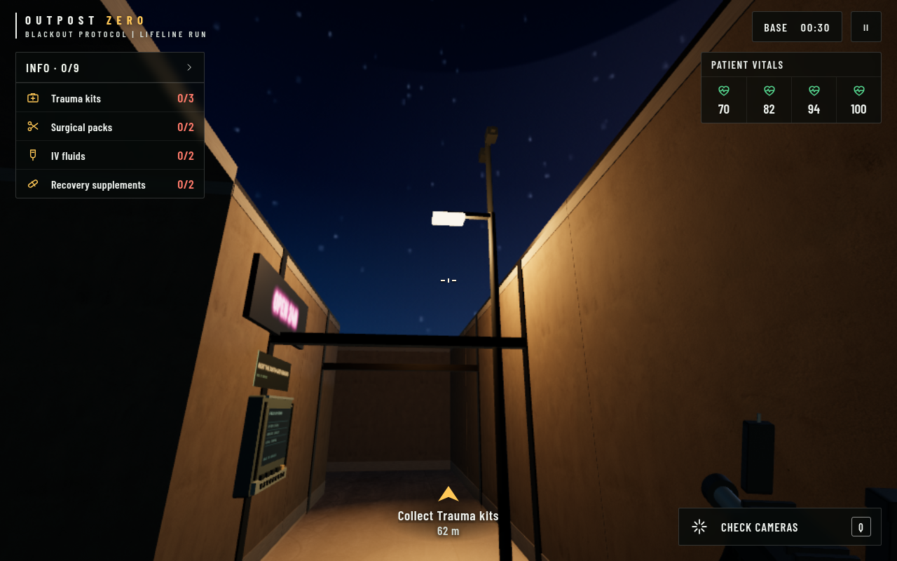 |  |
| Night ceiling lights | 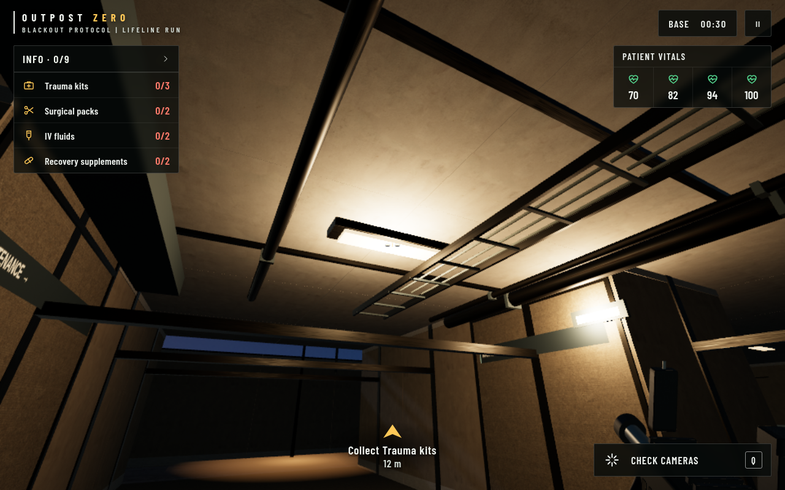 | 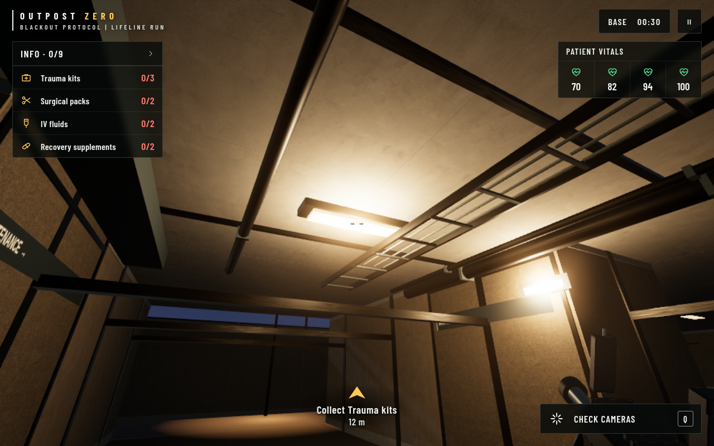 |
| Communications nameplate |  | 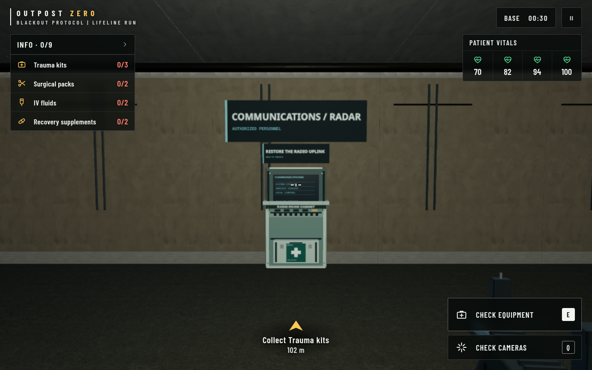 |
| Armed charge |  | 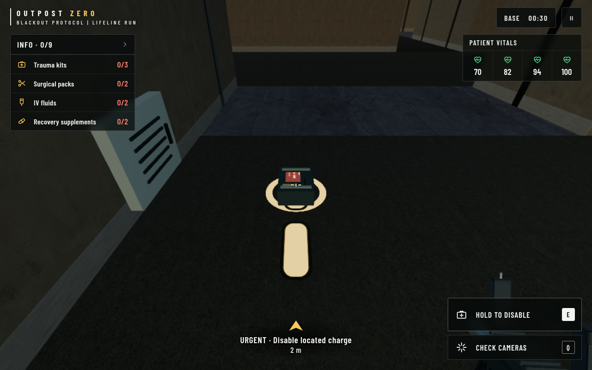 |
| Depot east aisle | 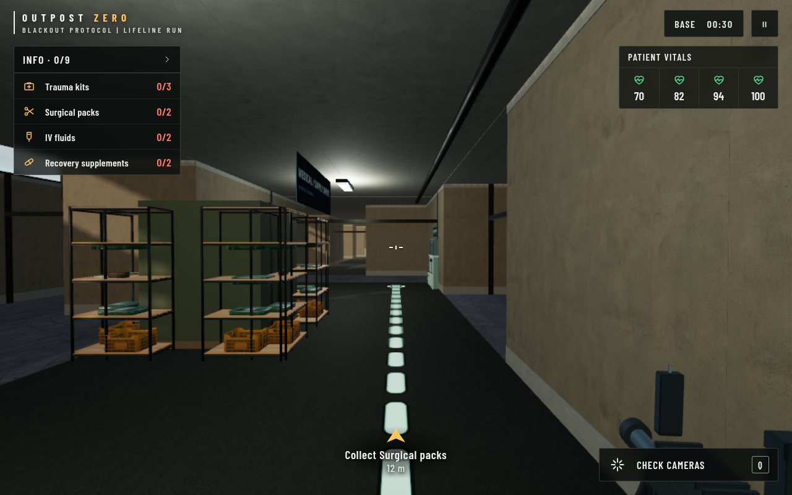 | 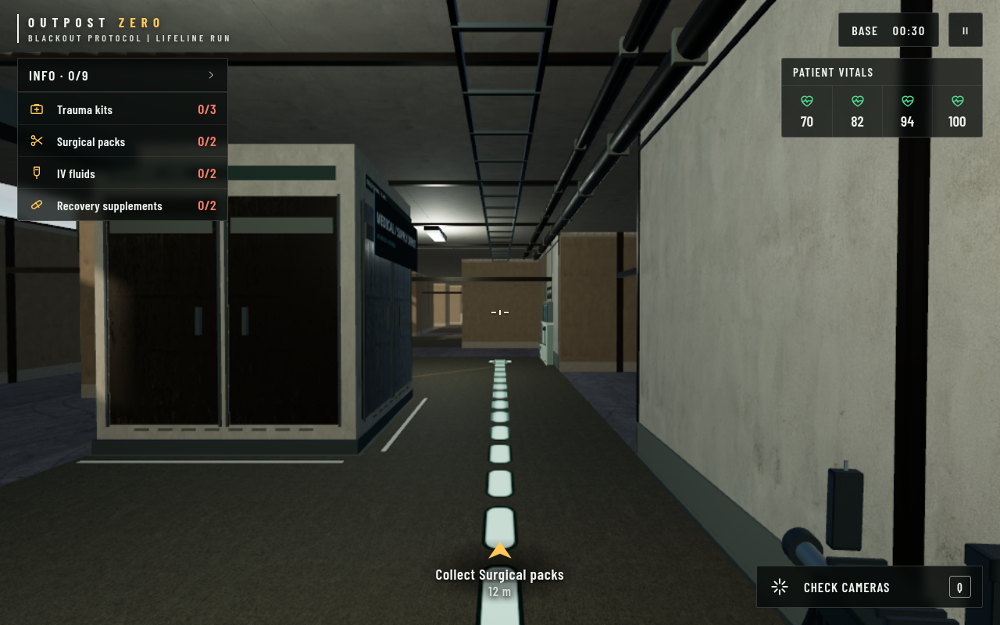 |
| Depot station | 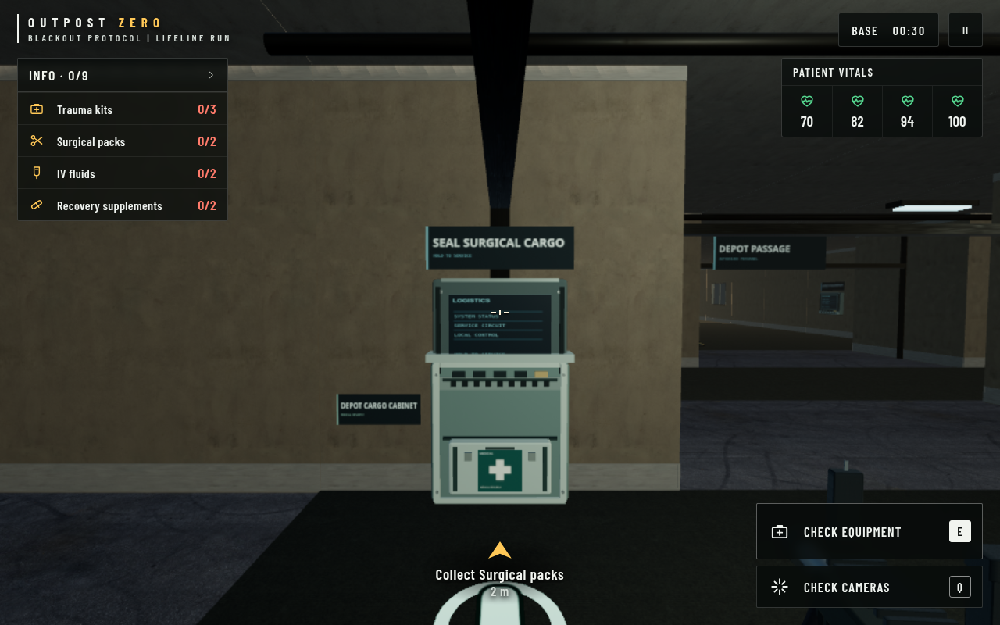 | 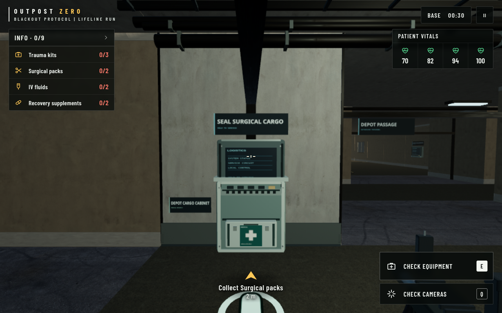 |
| Depot entrance | 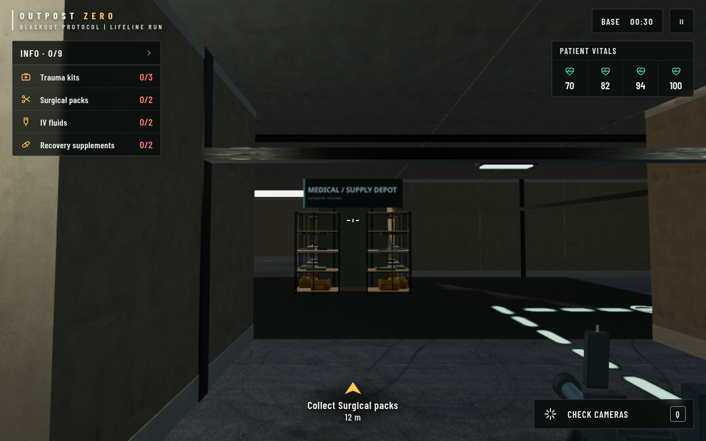 | 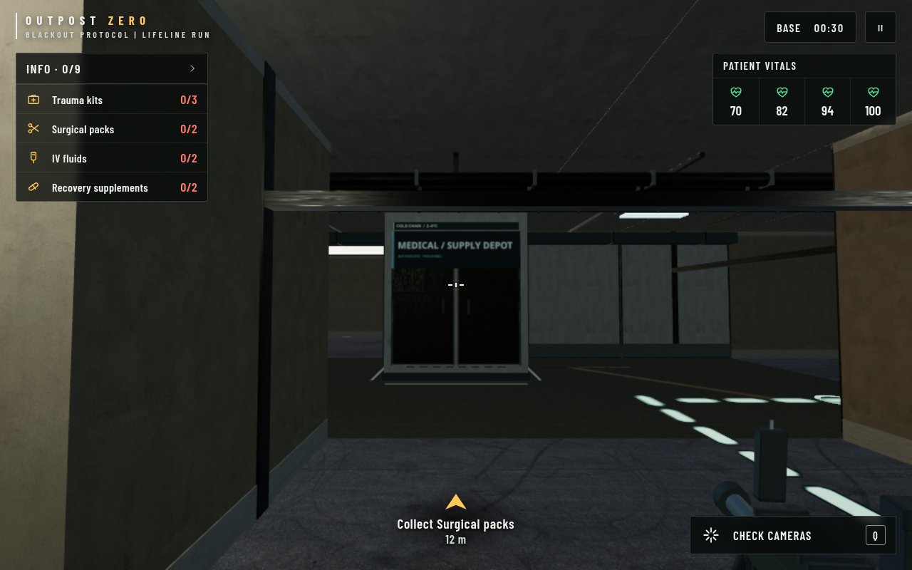 |
| Depot at night | 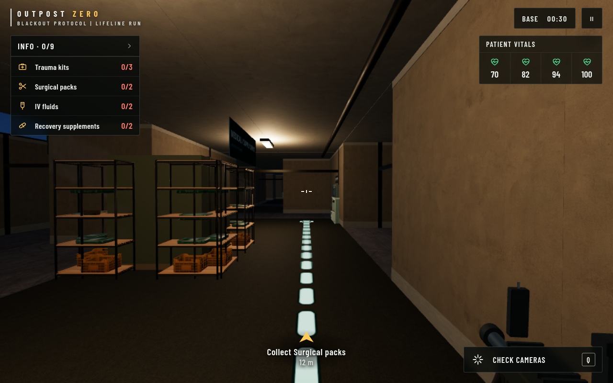 | 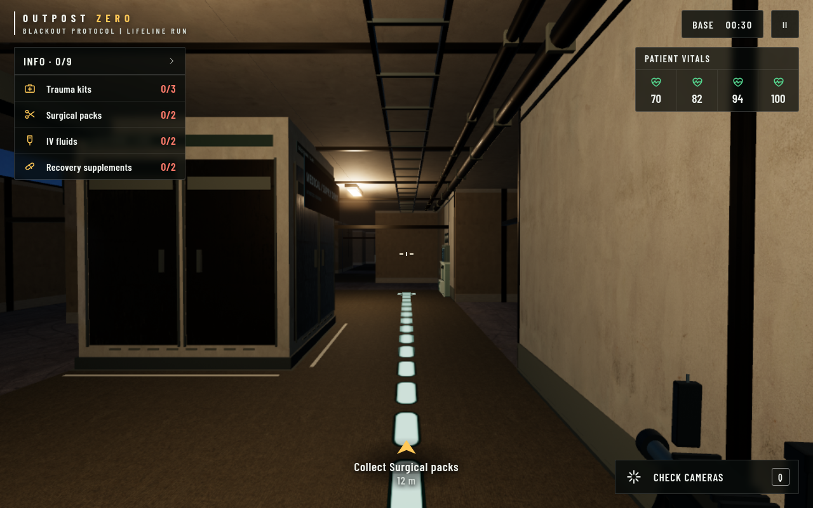 |

## Assets and licences

No new third-party asset downloads. Existing PBR photographs are reused under
Poly Haven's [CC0 licence](https://polyhaven.com/license):

| Surface | Exact source |
|---|---|
| Concrete floor | [brushed_concrete_03](https://polyhaven.com/a/brushed_concrete_03) |
| Painted plaster | [painted_plaster_wall](https://polyhaven.com/a/painted_plaster_wall) |
| Metal | [metal_plate_02](https://polyhaven.com/a/metal_plate_02) |

Architecture, reserve doors, fittings, charge status artwork, the revised
nameplate and the runtime 1024×256 wayfinding atlas are original procedural game
assets, not scanned production models. Provenance is also recorded in
`public/games/military/ATTRIBUTION.md` and the in-game asset credits. Existing
character/model licences, player dyes, LODs and animation clips are preserved.

## Validation completed

All required checks passed:

- `node --test scripts/outpost-*.test.mjs`: 37 passed, zero failures.
- `npx tsc --noEmit -p .`.
- `npm run build:outpost-military` and `NITRO_PRESET=render npm run build:render`.
  Release verification matched all 126 required files, including 13 operator
  sources and 18 photographic textures.
- `node scripts/check-outpost-loading.mjs`: desktop, mobile and missing optional
  loading artwork.
- Development and packaged interactable checks: desktop, mobile and blocked
  `benchmark-operator` PNGs. Optional response-map failures keep the game running.
- New room checks: all 188 fitting bounds, both movement routes with zero blocked
  moves, storage removal/rebuild, unchanged collision and the existing 1.4-tile
  defuse boundary. Charge pulse extrema, reduced-motion/SAFE states, label
  placement and all preset/day/night bloom policies also passed.
- Packaged corridor regression: movement, four uniform dyes, both LODs, existing
  Run gait fallback, sabotage lighting and exposure transitions. The existing
  charge lifecycle and aircraft departure checks still pass.
- Site smoke on development and packaged desktop/mobile: visible content, no
  console/page errors, no horizontal overflow or divergence from the baseline.

The final rebuild includes a credit-name correction to the existing
`metal_plate_02` normal map; asset bytes did not change. Its renderer SHA-256 is
`15b7ef22bc14dd83e6d5b510c3fa62c949ef4e860bb80c5086d57a407d456f1d`, identical
to the bundle used for the captured measurements and gameplay checks.

Evidence: [room/interactable development](qa-dev.json),
[room/interactable packaged](qa-built.json),
[packaged corridor](corridor-qa-built.json), [site development](site-dev.json),
[site packaged](site-built.json), [mobile game](images/mobile.png),
[SAFE charge](images/charge-disabled.png).

## Files changed

| Files | Purpose |
|---|---|
| `scripts/outpost-military/renderer.js` | Night bloom policy, room floor material and room integration |
| `scripts/outpost-military/interactables.js` | Communications label and charge indicator |
| `scripts/outpost-military/room-medical-depot.js` | Isolated room kit, atlas and bounds diagnostics |
| `scripts/outpost-military/realism-environment.js` | Instanced room integration and cached UV texture lifetime |
| `scripts/outpost-military/realism-night.js` | Batch existing opaque lamp/sign assemblies |
| `scripts/outpost-military/benchmark-corridor.js` | Expose the existing warm practical material for reuse |
| `scripts/benchmark-outpost-medical-depot.mjs`, `scripts/qa-outpost-medical-depot.mjs` | Fixed-camera measurements and room regression checks |
| `scripts/check-outpost-interactables.mjs`, `scripts/check-outpost-corridor.mjs`, `scripts/verify-outpost-corridor-built.mjs` | Preserve earlier evidence and run this review's development/packaged checks |
| `public/games/outpost-military.js` | Rebuilt renderer bundle |
| `src/routes/games/outpost-zero.tsx` | Updated iframe cache token |
| `public/games/military/ATTRIBUTION.md`, `public/games/outpost-asset-cache.js` | Original-art credits and precise reused texture provenance |
| `docs/graphics-benchmark/` | This report, captures and measurements; earlier report index and a texture-source citation corrected |

## Review boundary and limits

Power Passage and the remaining rooms have no new room-specific environment
art. After approval, Power Passage will get the next isolated material/detail
pass, with its own fixed-camera baseline, clearance tests and matching budget.

The sandbox uses SwiftShader software rendering. Draw calls and triangle counts
are useful here; timings are not hardware FPS. Source-texture estimates exclude
render targets, PMREM/MSAA and driver allocations; bloom colour targets are
reported separately. Physical iPad Safari and mobile GPU testing is still needed
before release. The room assets remain authored procedural geometry with reused
photographic materials; this is an incremental fidelity pass.
