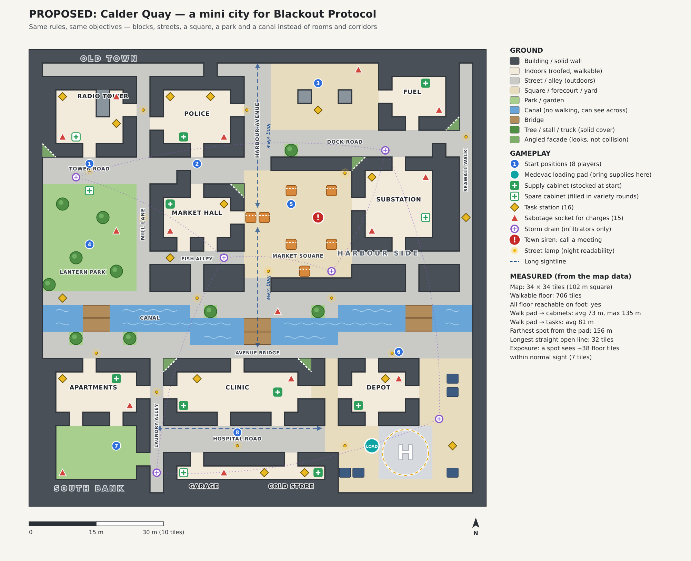
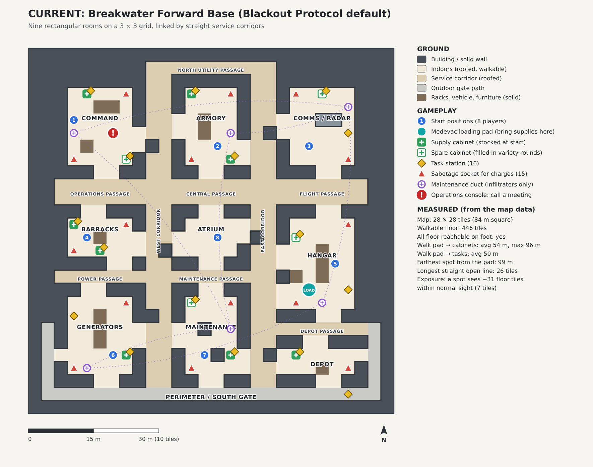

# Mini city plan: Calder Quay (design only, nothing built yet)

## In short

- **Which map the feedback is about.** "Rooms and corridors" describes **Breakwater Forward Base**, the starting map of Blackout Protocol (the default mode). Its top-down view is literally nine rectangular rooms in a 3 × 3 grid joined by straight service corridors (see `docs/current-map.png`). The Last Signal arenas are open walled yards, not rooms and corridors, so the feedback is not about them.
- **The proposal.** Swap Breakwater for **Calder Quay** (working name), a small harbour town. It has irregular blocks, streets of different widths, tight alleys, a market square, a park, a canal with three bridges, and ten landmark buildings you can recognise from far away (radio tower, police post, market hall, fuel station, substation, apartments, clinic, depot, garage, cold store). Drawing: `docs/mini-city-plan.png`.
- **The game rules stay the same.** Every objective in Breakwater gets a place in the town: 16 tasks, 12 supply cabinets, 15 sabotage sockets, 6 infiltrator shortcuts (storm drains instead of ducts), 8 start points, the meeting button and the medevac loading pad. They keep their current IDs, so the rules, the bots and most tests work unchanged. The flight and the field hospital are not touched.
- **The engine can do this.** The town is still built on the game's square tile grid, so movement, bot routes and line of sight work the way they do today. Angled building fronts are added as looks only. Two things need small engine changes: canal water you can see across but can't walk through, and street lighting for night and blackout. Rooftops, raised walkways and second floors are **not** possible without a large engine rewrite. They are left out.
- **Recommendation.** Make Calder Quay the new Blackout Protocol base, replacing Breakwater as the default. Keep Breakwater playable behind a setting until the town has been play-tested, then retire it. Don't make it a Last Signal arena now.
- **Size of the job.** About 4 phases. The layout and rules part is medium. The 3D art is the large part. A playable grey-box version can be tested before any art is made.

---

## 1. What the feedback is about

| Mode | Map | Shape today |
|---|---|---|
| Blackout Protocol (default) | **Breakwater Forward Base**, 28 × 28 tiles (84 m) | 9 rooms on a 3 × 3 grid, 2 long north–south corridors, 3 east–west passages. Every room is a rectangle. |
| Blackout Protocol, act 2 | Lifeline Medevac (aircraft) | Small aircraft interior; it should stay that way. |
| Blackout Protocol, act 3 | Saint Brigid Field Hospital | Small open landing zone with tents; it is already outdoors. |
| Last Signal | Dust Outpost, Skyport, Wreck Estate (+ Freight, Test Block) | Open walled yards with cover, not rooms and corridors. |

So the change is about **Breakwater**. The player's "top-down view" is the map in **Info** and the minimap, which draw the room rectangles.

## 2. The concept: a compact harbour town

The current map, drawn in the same style and at the same scale, for comparison:

### Districts and streets
- **Old Town (north-west):** the Radio Station with its mast, the Police Post and the Market Hall. They are reached along **Mill Lane** (a one-tile alley) and **Tower Road** (a wider road that narrows at one point).
- **Harbour Avenue (centre):** the one long north–south avenue. A clock memorial in the middle of **Market Square** splits it, so you never see the full length in one go.
- **Market Square:** the town's centre. It is open paving with market stalls as cover, and the **town siren** (the meeting button) is here.
- **Harbour Side (north-east):** the fuel station forecourt, **Dock Road** and the Power Substation. Dock Road is deliberately offset one row from Tower Road, so the two never form one straight east–west line.
- **Lantern Park (west):** grass with trees that break up sightlines, plus a spare supply kiosk.
- **The canal:** it crosses the whole town and bends one row south in the middle. There are three bridges (Mill footbridge, Avenue Bridge, Dock bridge). The bridges are natural choke points, which suits a hidden-saboteur game: "who crossed the bridge?" becomes a useful question in meetings.
- **South Bank:** the Apartments with an enclosed back courtyard (a quiet, risky spot), **Laundry Alley**, the Clinic, **Hospital Road**, the Garage, the Cold Store, and the **Depot yard with the helipad**, where the medevac is loaded.

### Landmarks (for finding your way)
Each landmark has one feature you can spot from a distance: the **radio mast** (the tallest object in town, visible from almost everywhere), the police post's **blue lamp**, the **lit fuel sign**, the **market hall's glass roof and clock**, the **humming transformer yard**, the **five-storey apartment block** with washing lines, the clinic's **red cross**, and the **depot crane** and helipad. Street names are painted on walls at each corner.

### Varied sightlines
- Long views: Harbour Avenue (about 10 tiles on each side of the memorial), the two quays along the canal, and Hospital Road.
- Tight spaces: Mill Lane, Fish Alley with its dog-leg down to the quay, Laundry Alley, the blind nook behind the police post, and the apartment courtyard.
- Seeing across the canal: you can look across the water but must walk to a bridge to get there.

### Day and night
- **Day:** sunlight on open streets and shade inside buildings. Each district has its own colour (warm stone in Old Town, painted metal and concrete at Harbour Side, brick on South Bank), so a screenshot tells you where you are.
- **Night shift and blackouts:** 14 street lamps are placed at junctions and bridges (yellow dots on the drawing), and the windows of the landmarks are lit. When the power is cut, the lamps go out, as room lights do today, so the blackout still feels dramatic. The emergency torch and the 2.6-tile blackout sight limit stay as they are.

### Where each gameplay function goes

| Gameplay function | Breakwater today | Calder Quay |
|---|---|---|
| Medevac loading pad (carry supplies here, board) | Vehicle Hangar | **Depot yard, next to the helipad** (outdoors) |
| Supply cabinets (12; 8 stocked in a normal round) | Armory, barracks, command, depot, generators, maintenance, etc. | Police first-aid locker (2 trauma kits), stairwell medic box, clinic theatre cabinet and fluid fridge, depot cabinet, cold-store IV rack, market dry stores, fuel-shop shelves; spare cabinets in the radio room, substation, garage and park kiosk |
| Task stations (16) | One or two per room | Same 16 tasks with the same IDs and kinds, reworded for the town (e.g. "Check the street cameras" at the police post, "Fill the medevac fuel bowser" at the fuel station, "Run the canal pump" on the quay) |
| Power repair (when power is cut) | Generators room | **Substation** + cold store |
| Communications repair (when radio is jammed) | Comms / Radar room | **Radio Station** under the mast |
| Meeting / emergency button | Operations console in Command | **Town siren in Market Square** |
| Sabotage sockets for charges (15) | Behind racks in each room | Utility spots: mast cable tray, evidence room, fuel-tank hatch, market cellar, transformer, bandstand panel, boiler room, oxygen manifold, garage pit, crane box, bridge junction box, etc. |
| Infiltrator shortcuts (6) | Maintenance ducts | **Storm drains** at the same kind of spread, linked the same way |
| Start points (8) | One per room | Spread across all districts (numbered 1–8 on the drawing) |
| Mid-match events | Fires in rooms, a casualty at the south gate, a supply drop in the atrium | Fires at the market hall, fuel shop, apartments and garage; a casualty on Avenue Bridge; a supply drop in Market Square |

The flight (Lifeline Medevac) and the field hospital stay exactly as they are.

## 3. What the engine can and can't do

**How maps work today** (checked in the code):
- A map is a square grid of tiles (1 tile = 3 m). Each tile is either floor (0) or a solid type (1–6). This is in `public/games/outpost-protocol-map.js` (`level`, `rooms`, `stations`, `sites`, `vents`, `supplies`, `loading`, `emergency`, `spawns`, `props`).
- **Collision** (`canMove` in `outpost-sim.js`) checks the four corners of a small square around each person against the grid.
- **Line of sight** (who can see whom, witnesses, finding bodies and charges) casts a ray through the grid, and any solid tile blocks it. Normal sight is 7 tiles, 5 on Night shift and 2.6 during a blackout (`sightRange` in `outpost-variety.js`). The same limit applies to bots and players.
- **Bot routes and the player's objective arrow and trail** use a step-by-step search over floor tiles in four directions (`pathTo` in `outpost-sim.js`, `navigationRoutes` in `outpost-navigation.js`).
- **The 3D world** (`scripts/outpost-military/renderer.js`) turns every solid tile into a 3.5 m-tall wall block. Blocks of the same type are grouped together so they are cheap to draw. Each room rectangle gets a floor, a roof, lights and a sign (`buildProtocolBase`, `architecture.js`). Last Signal already swaps plain blocks for modelled pieces such as hedges, containers and HESCO (`arena-style.js`). The only level-of-detail system is for characters (a lighter model for far-away soldiers). Walls and props have no far-away versions.

**What works with no engine change**
- Irregular blocks, varied street widths, alleys, plazas, parks, dead ends and dog-legs: these are all just different shapes of tiles.
- Outdoor areas: Breakwater's south gate and the hospital's landing zone are already outdoors (`roofed: false`).
- Trees, stalls, parked trucks and fuel pumps as solid cover tiles that also block sight.
- Irregular buildings: each one is drawn as several rectangles that share one name.

**What works as looks only**
- **Angled or curved building fronts** (green triangles on the drawing) can be drawn over square tiles. To avoid an invisible-wall feel, the small leftover corner is filled with something you can't walk into anyway, such as a planter, steps or bollards. Use these sparingly, mainly on landmark corners.
- Varied building heights, roof shapes, the mast, the crane, awnings and balconies. The engine has one floor level, but what is drawn above head height is free.

**What needs small engine changes (medium)**
1. **Canal water** needs a new tile type that blocks walking but not sight or shots. Today every solid tile blocks sight, so you could not see anyone across the canal and people would seem to vanish. The change is one "see-through" check in the line-of-sight ray (shared by the game, the bots and the online server), plus a water surface in the renderer. The parts are `cast` and `visible` in `outpost-sim.js`, the visibility check in `outpost-protocol.js`, and `visibleWorldCells` in the renderer. Fallback if this is not wanted: a dry canal or a railway cutting that blocks sight the way a wall does.
2. **Street lighting outdoors.** Room lights today only light the room you are in (2 lights on phones, 4 on computers). Street lamps would be glowing fittings plus painted pools of light on the ground, not real lights, so the light budget stays the same.
3. **Remove the code that only fits Breakwater.** A number of places check for `"breakwater"` by name: wall height, roof chunks, room-by-room hiding of hidden parts, night dressing, and the five detailed room-decoration files (`room-*.js`, `benchmark-corridor.js`). Event spots (`outpost-events.js`), the practice drill (`outpost-practice.js`) and online rooms (`rooms.server.ts`) also name Breakwater. These need to accept the new map ID.

**What is not feasible (large engine rewrite)**
- **Rooftops, raised walkways and second floors.** The game world is one flat grid with one floor height. Shots and sight are calculated in 2D, and Blackout Protocol has no jumping or climbing. Bridges work only because they are at street level. Recommendation: don't do this.
- **True diagonal walls for collision.** Collision is square tiles, so diagonals are looks only (see above).

**Risks and how to handle them**

| Risk | What to do |
|---|---|
| **Walking is longer.** Measured from the map data: from the loading pad to the cabinets is 73 m on average in the city vs 54 m in Breakwater, and the farthest spot is 156 m vs 99 m. The town has 706 walkable tiles vs 446. | Either shrink the town to about 30 × 30, or move the stocked cabinets closer to the depot, or give the base phase a little more time. Measure with bot rounds before the art pass (the existing 30-seeded-round check). |
| **More witnesses.** In the open, a spot can see about 38 floor tiles within normal sight vs 31 in Breakwater, so infiltrators are seen more often. | Keep the sight limits as they are (bots never see further than a player could). Add more blocking cover (trees, stalls, kiosks) and quiet pockets (courtyard, blind nook, alleys). Re-check the infiltrator win rate in bot rounds. |
| **Long sightlines across the map** (the quay is 32 tiles long). | Game sight is still capped at 7 tiles, so no bot or rule gets an advantage. Fog and stalls keep the 3D view readable. Planters on the quay break the line. |
| **Bots in open areas.** Bot routes follow the four-direction grid, so in squares they walk in L-shapes. | This is a looks issue only. Smooth the walking line later if it looks robotic. Open areas should keep a few cover tiles so `coverFrom`-style choices still work. |
| **Phone performance.** Today's budget is ≤ 520 draw calls (Balanced patrol ≈ 481 on Breakwater). Outdoors you see more of the map at once. | Build buildings from a small kit of modelled pieces drawn in batches (like `arena-style.js`), group them by area as Breakwater's walls already are, hide whole blocks that are out of view, use plain boxes for distant facades, and draw the mast and crane once. Measure with `draw-calls.mjs` at the worst views (square, avenue, quay). |
| **Lost graphics work.** The detailed Breakwater room art (Command, Comms, Medical depot, Central passage, Supply atrium) would not be used. | Some of it can be reused inside the town's buildings: the comms room becomes the Radio Station interior and the medical depot becomes the Clinic or Depot. |
| **Tests assume Breakwater.** For example, the map test expects a size of 26–30 tiles. | Add a city version of the map tests (sealed edges, everything reachable, sockets not on task tiles, drains linked both ways), plus a water/see-through test. |

## 4. Build plan

| Phase | What | Size | Playable result |
|---|---|---|---|
| **0. Decide** | Owner picks the options below. | – | – |
| **1. Grey-box town** | Turn `scripts/outpost-city/layout.mjs` into a real map entry next to `PROTOCOL_MAP`, with a setting to choose it. Plain wall blocks; canal drawn as a dry ditch (blocks sight) for now. Update event spots, practice drill, online rooms and the Info map. Add the map tests. Run bot rounds and compare round length and crew/infiltrator wins with Breakwater. | Medium | Fully playable, ugly. Owner play-tests the layout on laptop and phone. |
| **2. Engine extras** | See-through water tile (game + server + bots), street lamps that go out in a blackout, generalise the Breakwater-only renderer checks, and smoother bot walking in open areas (optional). | Medium | The canal reads correctly and night play works. |
| **3. Art pass** | Building kit (facades, shopfronts, roofs, balconies, angled corners), street dressing (lamps, signs, stalls, trees, cars), landmarks (mast, crane, clock, blue lamp, fuel canopy), water and bridges, district colours, night windows. Reuse comms and depot room art inside buildings. Check performance on phones. | Large | Release candidate. |
| **4. Release** | Make it the default Blackout base, keep Breakwater behind a setting for a few weeks, then retire it. Update the loading-screen briefing, the manual and the field guide. | Small | Live. |

**Decisions the owner needs to make**
1. **Replace or add?** Replace Breakwater as the default base (recommended), or offer both as a choice.
2. **Size:** keep 34 × 34 (busier, about 35 % longer walks) or trim to about 30 × 30 (closer to today's pace).
3. **Canal:** real water you can see across (needs Phase 2) or a dry ditch/railway cutting (no engine change).
4. **Name and setting:** "Calder Quay" is a placeholder. Is it a coastal town being evacuated, or another setting?
5. **Breakwater's room art:** OK to reuse parts inside the town's buildings and retire the rest?
6. **Last Signal later?** Should the town also become a Last Signal arena after it ships? (Not recommended now; see below.)

## 5. Which mode it belongs to (recommendation)

**Recommended: the city replaces Breakwater as the Blackout Protocol base.** That is where the feedback came from, and a town fits the story well: gather medical supplies around an evacuated town, load them at the depot helipad, fly out. The objectives map one-to-one, so nothing in the rules has to be redesigned.

**Not recommended now: a new Last Signal arena.** Last Signal arenas are already open yards, were recently enlarged and tuned for round length, and have their own disaster and canister systems. Once the town's art kit exists, a smaller "town edge" arena could be made from it cheaply. That is a later option, not part of this job.

---

### Files in this plan
- `docs/mini-city-plan.png` / `docs/mini-city-plan.svg`: proposed layout.
- `docs/current-map.png`: Breakwater today, drawn the same way.
- `scripts/outpost-city/layout.mjs`: the town as data (grid, named areas, all objectives with their Breakwater IDs).
- `scripts/outpost-city/stats.mjs`: measurements (reachability, walking distances, exposure).
- `scripts/outpost-city/render.mjs`: draws both maps. Run `node scripts/outpost-city/render.mjs`.
